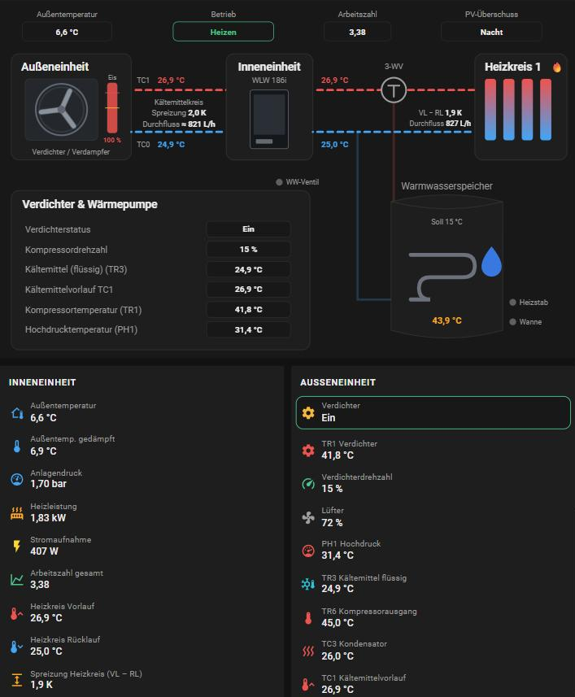

# Heizung Schema – Buderus WLW186i für Home Assistant

[](https://my.home-assistant.io/redirect/hacs_repository/?owner=WLW186iMuro&repository=heizung-schema-card&category=plugin)

Anlagenschema im Stil des Bosch-HMI-800 für die Luft-Wasser-Wärmepumpe **Buderus Logatherm WLW186i** (Bosch-Schwestermodell: Compress 5800i/6800i AW), ausgelesen über [EMS-ESP](https://emsesp.org).

- links die Werte der Inneneinheit, rechts die der Außeneinheit, in der Mitte das Schema mit Kältemittelkreis, Heizkreis, Warmwasserspeicher
- Verdichter dreht sich nach Drehzahl, Leitungen zeigen die Fließrichtung, Abtauen (4-Wege-Ventil) und geschätzte Vereisung werden angezeigt
- Spreizung und Durchfluss von Primär- und Heizkreis, im Warmwasserbetrieb passend ausgeblendet
- Farben folgen deinem Theme, ein Klick auf einen Wert öffnet die Entität



## Installation

1. Auf **Open in HACS** klicken. Alternativ: HACS → ⋮ → *Benutzerdefinierte Repositories* → diese Repository-URL, Kategorie **Dashboard**.
2. **Herunterladen**. HACS trägt die Ressource selbst ein und hält sie aktuell.
3. Browser-Cache leeren (Strg+F5), dann ist die Karte `Heizung Schema` in der Kartenauswahl.

Dashboards im YAML-Modus: Ressource `/hacsfiles/heizung-schema-card/heizung-schema-card.js` als *JavaScript-Modul* von Hand eintragen.

## Dashboard anlegen

Das Schema braucht Platz, deshalb als eigenes Dashboard mit Ansichtstyp **Panel**. Fertige Konfiguration zum Einfügen: [`examples/dashboard.yaml`](examples/dashboard.yaml).

```yaml
type: custom:heizung-schema-card
```

Mehr ist bei Standardnamen nicht nötig.

## Voraussetzungen

- Home Assistant mit EMS-ESP (MQTT-Discovery). Die Karte erwartet die Standardnamen `sensor.boiler_…`, `binary_sensor.boiler_…`, `sensor.thermostat_…`.
- Die Texte der Betriebsart (`Heizen`, `Warmwasser`, `Abtauen`) werden deutsch und englisch erkannt. Bei anderer Spracheinstellung von EMS-ESP kann die Anzeige der Betriebsart abweichen.

## Optionen

```yaml
type: custom:heizung-schema-card
side_width: 190              # Breite der Seitenspalten in Pixel
center_background: "#181818" # Hintergrund des Schemas (Standard: Theme)
entities:                    # abweichende Entitäten, nur die nötigen angeben
  outdoor: sensor.boiler_outdoortemp
  cop: sensor.meine_arbeitszahl
```

## Entitäten

Heißt eine Entität bei dir anders, steht an der Stelle „–“. Dann in *Entwicklerwerkzeuge → Zustände* nach `boiler_` filtern und den Schlüssel unter `entities:` überschreiben.

**Aus EMS-ESP (Standardnamen):** `outdoor`, `outdoor_damped` (`sensor.thermostat_dampedoutdoortemp`), `pressure`, `el_power`, `flow`, `ret`, `flow_rate`, `target_flow`, `dhw_actual`, `dhw_set`, `valve3`, `dhw_charging`, `heating_active`, `comp_on`, `comp_speed`, `activity`, `fan`, `tr1`, `ph1`, `tr3`, `tr6`, `hp4way`, `pc0flow`, `tc3`, `tc1`, `tc0`, `tl2`, `ta4`, `pan_heater`, `aux_heater`

**Rechnet die Karte selbst, wenn die Entität fehlt** (nichts anzulegen):

| Schlüssel | Anzeige | Berechnung |
|---|---|---|
| `heat_power` | Heizleistung | Durchfluss Heizkreis × 1,163 × (Vorlauf − Rücklauf) |
| `cop` | Arbeitszahl gesamt | Wärmemenge ÷ Strom aus `boiler_nrgtotal` / `boiler_metertotal` |
| `pc0flow_calc` | Durchfluss Kältemittel, mit „≈“ | Kennlinie der Primärkreispumpe aus `boiler_hpcircspd` |

Die Kennlinie der Primärkreispumpe wurde an einer WLW186i-7 mit TP70 ermittelt. Bei anderen Größen ist der „≈“-Wert nur eine Näherung.

**Optional, ohne Ersatz:** `icing` und `icing_status` (geschätzte Vereisung des Verdampfers; ohne Entität zeigt die Karte „Aus“) und `pv_status` (Status einer PV-Überschuss-Steuerung; ohne Entität ist das Feld ausgeblendet).

## Datenschutz

Die Karte liest nur Zustände aus deinem Home Assistant im Browser. Sie sendet nichts ins Internet und speichert nichts.

## Hinweise

Privates Hobbyprojekt, keine Verbindung zu Bosch oder Buderus. Die Namen sind Marken der jeweiligen Inhaber. Nutzung auf eigene Verantwortung; die Karte verändert keine Einstellungen an der Heizung.

Lizenz: [MIT](LICENSE)
